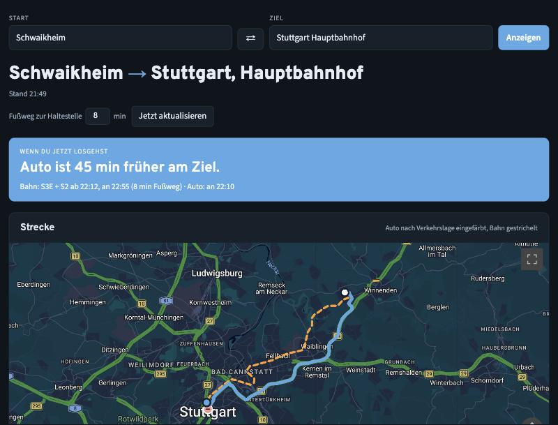
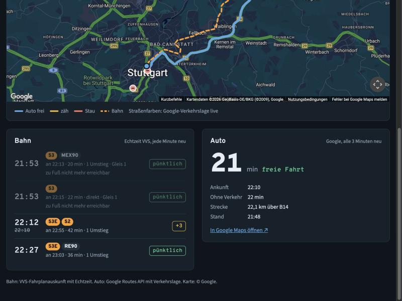

# Pendel: Bahn oder Auto?

Kleine lokale Web-App, die live zeigt, was gerade schneller ist: die Bahn oder das Auto.
Start und Ziel gibst du oben frei ein (Ort, Haltestelle oder Adresse).





## Was die App zeigt

- **Urteil:** „Auto ist 20 min früher am Ziel“, mit dem nächsten Zug, den du noch erreichst.
- **Karte:** Autostrecke nach Verkehrslage eingefärbt (frei, zäh, Stau), Bahnstrecke gestrichelt.
- **Bahn:** die nächsten vier Verbindungen mit Echtzeit-Verspätung, Gleis, Umstiegen und Ausfällen.
- **Auto:** Fahrzeit mit und ohne Verkehr, Kilometer, Route und Link zu Google Maps.

Bahndaten kommen jede Minute neu, Autodaten alle drei Minuten.

## Datenquellen

| Was | Quelle | Key nötig |
| --- | --- | --- |
| Bahn | VVS-Fahrplanauskunft (EFA) mit Echtzeit | nein |
| Auto | Google Routes API mit Verkehrslage | ja |
| Karte | Google Maps JavaScript API, sonst OpenStreetMap | optional |

Die Bahnauskunft deckt den Großraum Stuttgart (VVS) ab. Außerhalb findet sie oft keine Verbindung.

## Installation

Voraussetzung: Node.js 20 oder neuer.

```bash
git clone https://github.com/MarcBaumholz/pendel-dashboard.git
cd pendel-dashboard
npm install
cp .env.example .env
```

## Google-Keys anlegen

1. In der [Google Cloud Console](https://console.cloud.google.com/) ein Projekt wählen und Abrechnung aktivieren.
2. **Routes API** aktivieren und einen Key anlegen. Den Key auf „Routes API“ beschränken.
   In `.env` als `GOOGLE_MAPS_API_KEY` eintragen. Dieser Key bleibt auf dem Server.
3. Für die Google-Karte **Maps JavaScript API** aktivieren und einen zweiten Key anlegen.
   Den Key auf den HTTP-Referrer `http://localhost:4321/*` beschränken.
   In `.env` als `GOOGLE_MAPS_JS_KEY` eintragen. Ohne diesen Key zeigt die App eine OpenStreetMap-Karte.

Die Routes API hat 5.000 kostenlose Abfragen im Monat. Die App merkt sich jede Strecke drei Minuten lang
und bleibt so bei normaler Nutzung darunter.

## Starten

```bash
node --env-file-if-exists=.env web.mjs
```

Dann im Browser <http://localhost:4321> öffnen.

Eine Strecke lässt sich als Lesezeichen speichern, zum Beispiel
`http://localhost:4321/?start=Schwaikheim&ziel=Stuttgart%20Hauptbahnhof`.

## Einstellungen in `.env`

| Variable | Bedeutung | Standard |
| --- | --- | --- |
| `GOOGLE_MAPS_API_KEY` | Key für die Autofahrzeit | – |
| `GOOGLE_MAPS_JS_KEY` | Key für die Google-Karte | – |
| `PENDEL_START` | Start beim ersten Öffnen | Schwaikheim |
| `PENDEL_ZIEL` | Ziel beim ersten Öffnen | Stuttgart Hauptbahnhof |
| `PENDEL_AUTO_CACHE_SECONDS` | wie lange eine Autofahrzeit gilt | 180 |
| `PENDEL_PORT` | Port der App | 4321 |

## Weitere Wege, die Daten abzurufen

**Im Terminal** (Standardstrecke, mit `--watch` jede Minute neu):

```bash
node --env-file-if-exists=.env cli.mjs
```

**Als MCP-Server für Claude Code** (Tools `bahn_verbindungen` und `auto_fahrzeit`):

```bash
claude mcp add pendel -s user -- node --env-file-if-exists=$PWD/.env $PWD/server.mjs
```

## Dateien

| Datei | Aufgabe |
| --- | --- |
| `web.mjs` | lokaler Webserver: liefert die Seite und `/api/bahn`, `/api/auto`, `/api/config` |
| `app.html` | die Oberfläche mit Karte, Urteil, Bahn und Auto |
| `server.mjs` | Abfragen an VVS und Google, zugleich MCP-Server |
| `cli.mjs` | Ausgabe im Terminal |
| `dashboard.html` | ältere Version als Claude-Artifact (nicht mehr gepflegt) |
